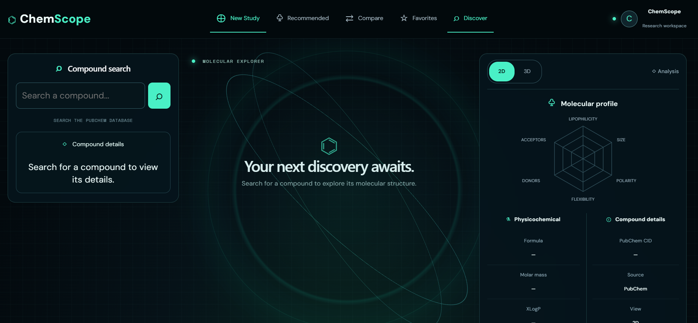
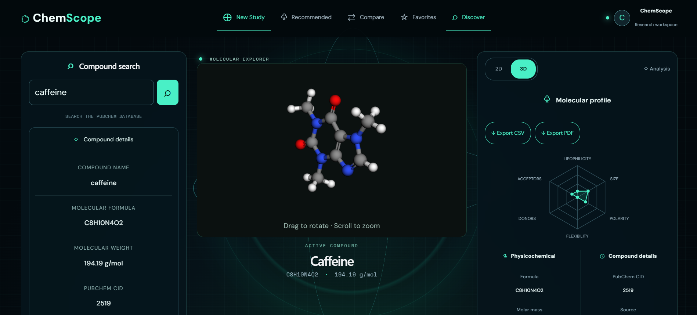
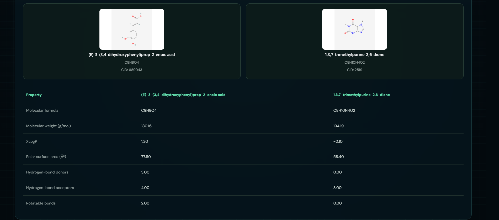
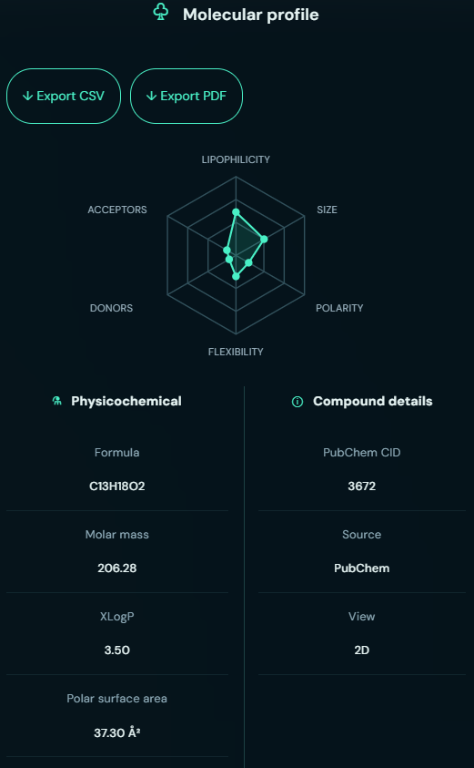

# ChemScope — Molecular Intelligence & Visualization

ChemScope is a web-based molecular exploration platform that combines chemical compound search, interactive 3D molecular visualization, molecular property analysis, and side-by-side compound comparison in a modern dashboard.

Built with React and FastAPI, ChemScope retrieves real compound information from PubChem and presents it through an interactive interface designed to make exploring chemical molecules more intuitive.

## Features

- **Compound Search:** Search chemical compounds by name using PubChem data.
- **Search Autocomplete:** Get compound suggestions while typing.
- **3D Molecular Visualization:** Explore molecular structures through an interactive 3D viewer.
- **2D and 3D Views:** Switch between two-dimensional and three-dimensional molecular representations.
- **Molecular Property Analysis:** View available chemical information, including molecular formula, molecular weight, and other molecular properties.
- **Property Radar Chart:** Visualize selected molecular properties through a radar chart.
- **Compound Comparison:** Compare two compounds side by side using their available chemical properties.
- **Recent Compounds:** Quickly revisit previously explored compounds.
- **Favorites:** Save frequently accessed compounds for future reference.
- **Copy SMILES:** Copy a compound's SMILES representation for use in other chemistry tools.
- **Report Export:** Export compound information and comparison results as CSV or PDF reports.
- **Responsive Dashboard:** Explore molecular information through a dark, science-inspired interface.

## Tech Stack

### Frontend
- React
- Vite
- JavaScript
- CSS
- 3Dmol.js
- Recharts

### Backend
- Python
- FastAPI
- HTTPX

### Data Source
- PubChem PUG REST API

### Storage
- Browser localStorage for favorites and locally stored preferences or history, as implemented in the application.

## Project Structure

```text
ChemScope/
├── backend/
│   └── main.py
├── frontend/
│   ├── src/
│   │   ├── App.jsx
│   │   ├── App.css
│   │   ├── index.css
│   │   └── MoleculeViewer.jsx
│   ├── package.json
│   └── ...
├── screenshots/
│   ├── dashboard.png
│   ├── molecule-3d.png
│   ├── comparison.png
│   └── molecular-analysis.png
└── README.md
```

## Screenshots

### Main Dashboard



### 3D Molecular Visualization



### Compound Comparison



### Molecular Property Analysis



## Getting Started

Follow these instructions to run ChemScope locally.

### Prerequisites

Install the following:

- Python 3.10 or later
- Node.js and npm
- Git

### 1. Clone the Repository

```bash
git clone https://github.com/Raksha-qq/ChemScope.git
cd ChemScope
```

### 2. Set Up the Backend

Open a terminal in the project root and run:

```bash
cd backend
python -m venv .venv
```

Activate the virtual environment.

**Windows PowerShell:**

```powershell
.\.venv\Scripts\Activate.ps1
```

Install the backend dependencies:

```bash
pip install "fastapi[standard]" httpx
```

Start the backend server:

```bash
fastapi dev main.py
```

The backend should now be available at:

- API: http://localhost:8000
- Interactive API documentation: http://localhost:8000/docs

Keep this terminal running.

### 3. Set Up the Frontend

Open a second terminal and navigate to the frontend directory from the project root:

```bash
cd frontend
npm install
npm run dev
```

Open the local URL printed by Vite, usually:

http://localhost:5173

Keep both the backend and frontend servers running while using the application.

## API Endpoints

ChemScope uses a FastAPI backend to retrieve compound information from PubChem.

| Method | Endpoint | Description |
|---|---|---|
| GET | `/api/health` | Check backend health |
| GET | `/api/compounds/{name}` | Retrieve information for a compound |
| GET | `/api/search/{query}` | Search for matching compounds |

The exact information returned depends on the backend implementation and the data available from PubChem.

You can explore and test these endpoints using the interactive API documentation at `http://localhost:8000/docs`.

## How It Works

1. A user searches for a chemical compound through the React interface.
2. The frontend sends a request to the FastAPI backend.
3. The backend queries PubChem using its PUG REST API.
4. The retrieved compound information is returned to the frontend.
5. ChemScope displays the available molecular properties, visualizations, and analysis.
6. Users can explore the molecule in 2D or 3D, compare compounds, save favorites, and export reports.

## Key Highlights

- Integrates a real chemical data source instead of relying exclusively on hardcoded compound information.
- Separates the frontend interface from the backend API.
- Combines molecular visualization with structured chemical property analysis.
- Supports side-by-side comparison to make compound exploration easier.
- Includes practical features such as autocomplete, favorites, and report exports.

## Future Improvements

- Add advanced chemical substructure and similarity search.
- Introduce additional molecular descriptors and analysis tools.
- Expand support for comparing multiple compounds.
- Add downloadable molecular structure files and richer export options.
- Improve accessibility and mobile responsiveness.
- Introduce user accounts and cloud-synced collections.

## Acknowledgements

- [PubChem](https://pubchem.ncbi.nlm.nih.gov/) for chemical compound data and its PUG REST API.
- [3Dmol.js](https://3dmol.org/) for molecular visualization.
- [FastAPI](https://fastapi.tiangolo.com/) for the backend framework.
- [React](https://react.dev/) for the frontend library.
- [Recharts](https://recharts.org/) for charting.

## License

This project is distributed under the MIT License, as indicated by the project's license configuration. See the repository's license file for the full terms.

---

**ChemScope** — Explore molecules. Visualize structures. Compare chemistry.